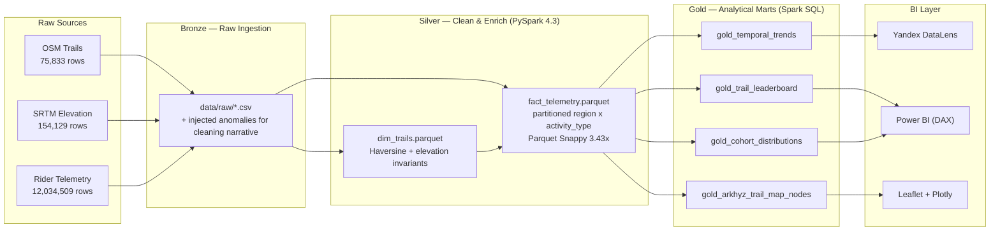
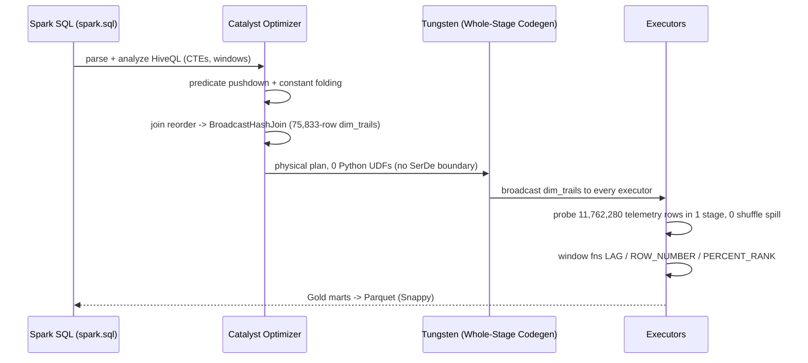
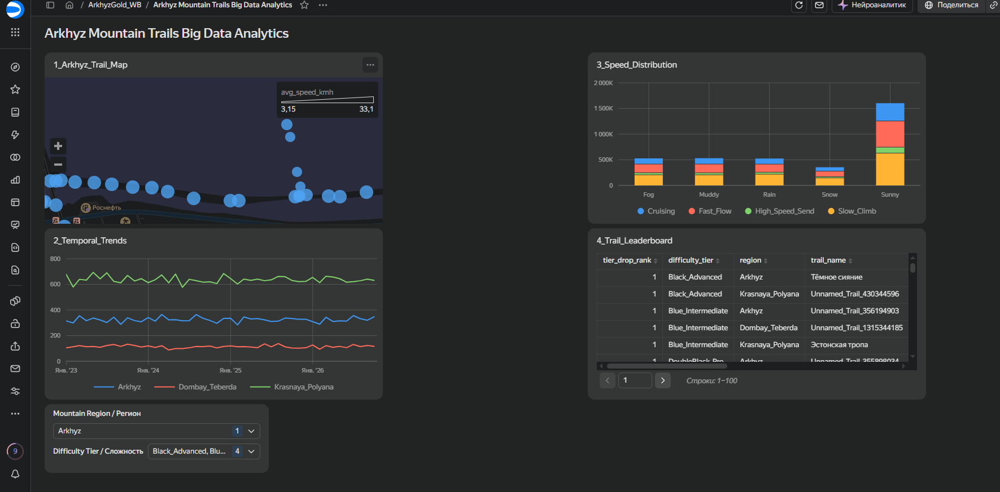
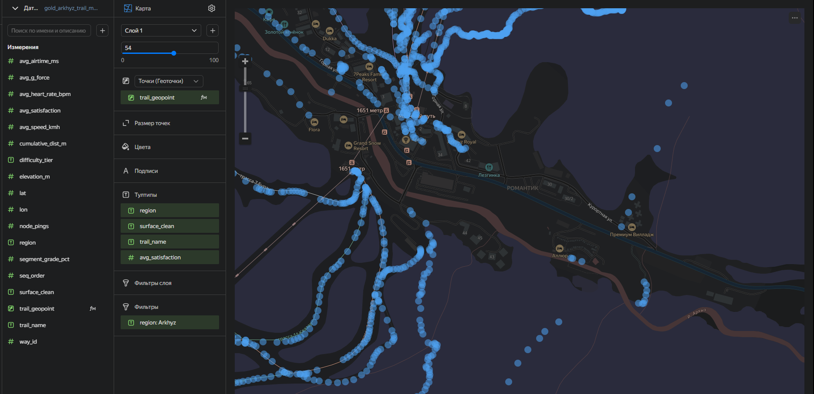
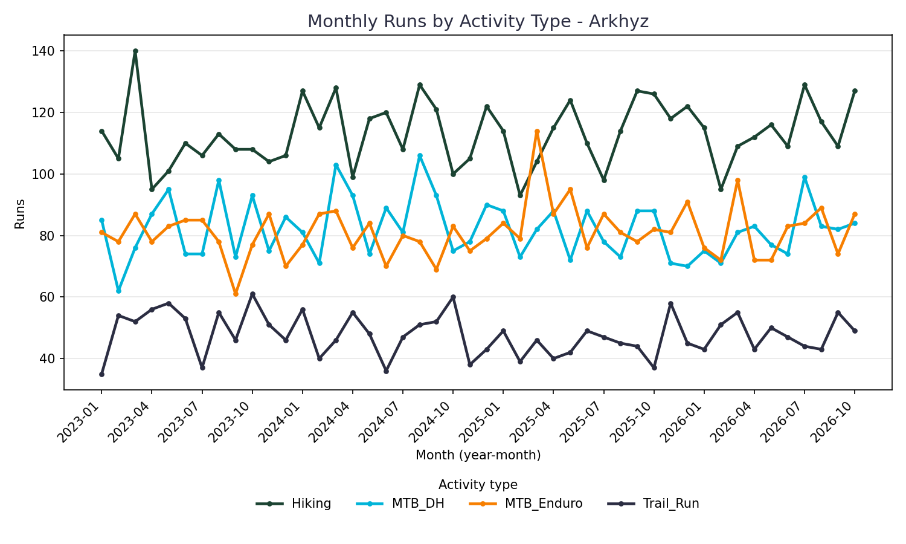
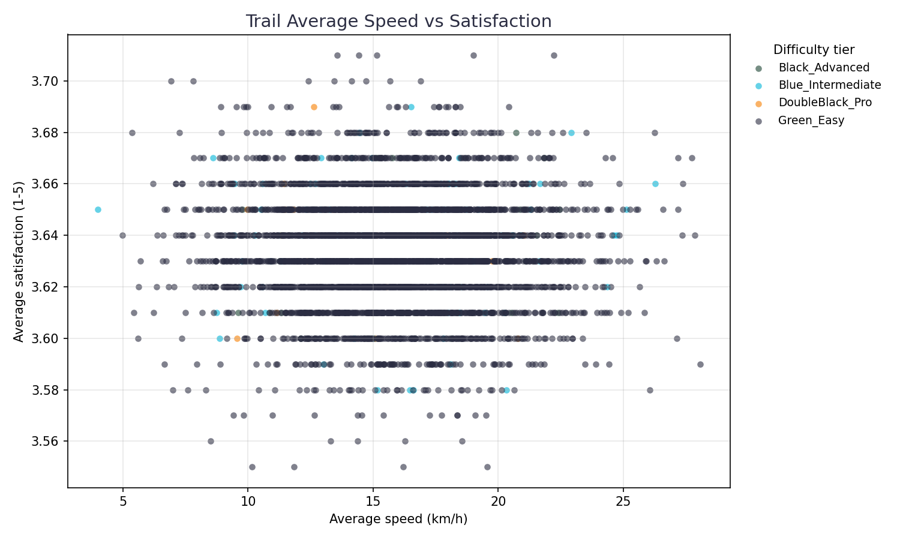
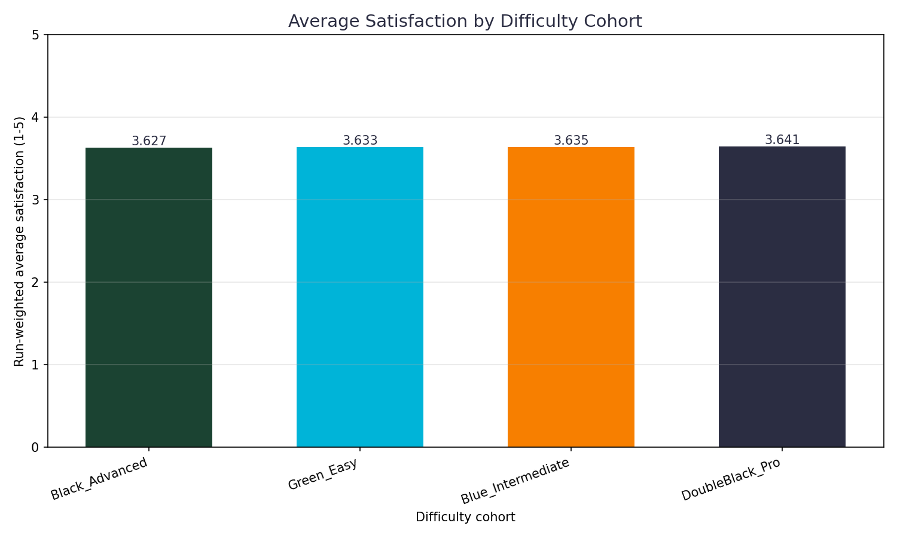
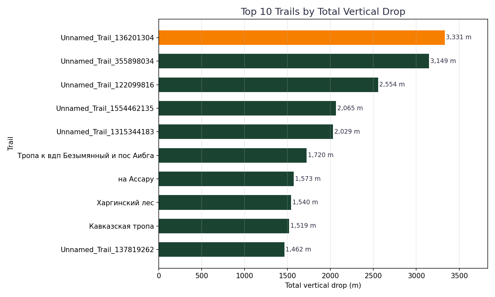

# Caucasus Trail Big Data Lakehouse

An end-to-end medallion lakehouse for mountain-trail telemetry across three
Caucasus regions, built with PySpark 4.3, Spark SQL / HiveQL and Parquet Snappy.


## Executive summary

This project turns raw OpenStreetMap trail geometry, SRTM elevation tiles and
rider telemetry into a queryable analytics layer. Stage 1 generates the raw
CSVs, Stage 2 cleans, enriches and joins them with PySpark into Parquet under
`data/processed/`, Stage 3 runs Spark SQL / HiveQL analytics (CTEs, window
functions, GROUP BY / HAVING) that materialize four Gold marts, and Stage 4
builds a static BI preview. The data covers 3 mountain regions (Arkhyz,
Dombay & Teberda, Krasnaya Polyana) and 12M+ telemetry points. The output feeds
Yandex DataLens, Power BI (with native DAX measures) and a Leaflet + Plotly
web view.

## Architecture

### Medallion architecture



### Catalyst / Tungsten execution



## Key Engineering Metrics

| Metric | Value |
| --- | --- |
| Telemetry / route points | 12,034,509 raw (11,762,280 clean) |
| OSM trail nodes / dim_trails rows | 75,833 |
| SRTM elevation grid points | 154,129 |
| Parquet Snappy compression | 3.43x (1,533.5 MB -> 447.6 MB) |
| Python UDFs | 0 (native pyspark.sql.functions) |
| Window functions | LAG, ROW_NUMBER, PERCENT_RANK |
| Gold data marts | 4 |
| Partition scheme | region x activity_type |
| Regions | 3 (Arkhyz, Dombay & Teberda, Krasnaya Polyana) |
| Pytest cases | 16 data-quality + release-audit + sample-smoke |

## Directory layout

```
caucasus_trail_lakehouse/
|-- src/
|   |-- stage1_prepare_data.py        # raw CSV generation
|   |-- stage2_pyspark_etl.py         # Bronze -> Silver PySpark ETL
|   |-- stage3_hivesql_analytics.py   # Spark SQL / HiveQL Gold marts
|   `-- stage4_generate_bi_preview.py # static BI preview + HTML dashboard
|-- data/
|   |-- raw/                          # generated raw CSVs (gitignored)
|   |-- processed/                    # dim_trails + fact_telemetry Parquet (gitignored)
|   |-- gold/                         # Gold marts Parquet + csv/ (gitignored)
|   `-- sample/                       # small deterministic fixtures (tracked)
|-- bi/                               # theme JSON, Power BI + DataLens guides
|-- docs/                             # docs and docs/assets screenshots
|-- tests/                            # data-quality, sample-smoke, release-audit
|-- notebooks/                        # notebook builder (generated output gitignored)
`-- requirements.txt
```

## Quickstart

Clone the repository and install the pinned dependencies:

```
git clone https://github.com/<owner>/caucasus_trail_lakehouse.git
cd caucasus_trail_lakehouse
python -m pip install -r requirements.txt
```

Verify the Windows Spark prerequisites (JDK, winutils, imports):

```
python src/stage2_pyspark_etl.py --check-env
```

Run the whole Bronze -> Silver -> Gold pipeline on the small tracked fixtures.
This takes ~2.5 min on a cold start, because Spark/JVM startup dominates:

```
python src/stage2_pyspark_etl.py --sample
python src/stage3_hivesql_analytics.py --sample
```

The sample run writes `data/sample/processed/` and `data/sample/gold/` (both
gitignored), so you can inspect the Parquet marts and CSVs without the 1.5 GB
production dataset.

## Full production run

Rebuild everything at production scale from the project root:

```
python src/stage1_prepare_data.py --size-gb 1.5
python src/stage2_pyspark_etl.py
python src/stage3_hivesql_analytics.py
python src/stage4_generate_bi_preview.py --html-only
```

Expected runtimes on a 6-core Windows machine: Stage 1 a few minutes (raw CSV
generation), Stage 2 roughly 10-25 min, Stage 3 roughly 3-5 min, Stage 4 a
minute or two. Stage 2 writes `data/processed/` (dim_trails.parquet and
fact_telemetry.parquet partitioned by region x activity_type); Stage 3 writes
the four Gold marts to `data/gold/` plus single-file CSVs to `data/gold/csv/`.

## Tests

```
python -m pytest tests/test_stage3_b7_qa.py -v
python -m pytest tests/test_sample_smoke.py -v
python -m pytest tests/test_public_release_audit.py -v
```

- `test_stage3_b7_qa.py` - 16 full-data data-quality tests over the local
  production marts (needs the full dataset, takes a couple of minutes).
- `test_sample_smoke.py` - runs the complete Bronze -> Silver -> Gold pipeline
  on `data/sample/` and checks every output exists (hard bound under 180 s).
- `test_public_release_audit.py` - leak and size scan over the release file
  set (no user paths, no hardcoded credentials, no oversized files), runs anywhere.

## BI and dashboard gallery

The Gold marts drive an interactive HTML dashboard and a Yandex DataLens
workbook; the matplotlib figures below come from the same Gold layer. See
[`docs/BI_LAYER.md`](docs/BI_LAYER.md) for the mart schemas, DAX measures and
DataLens setup.



*Yandex DataLens dashboard overview*



*Leaflet trail map (Gold mart)*



*Monthly runs by activity type (Arkhyz)*



*Average speed vs satisfaction per trail*



*Satisfaction by difficulty cohort*



*Top 10 trails by vertical drop*

## Environment prerequisites

- Python 3.13 (the pipeline uses `str.format()`, `pathlib`, `argparse`).
- JDK 17, discoverable via the `JAVA_HOME` environment variable. No JDK path is
  hardcoded in the repository.
- PySpark 4.3.0 plus pyarrow, pandas, numpy, requests, matplotlib and
  jupyter-client (all pinned in `requirements.txt`).
- On Windows, `winutils.exe` and `hadoop.dll` are auto-bootstrapped into
  `.hadoop/bin` by Stage 2, so no manual Hadoop install is required. Spark
  workers use `PYSPARK_PYTHON=sys.executable` and the session timezone is UTC.

## Interactive HTML dashboard

`bi/arkhyz_interactive_dashboard.html` (~39 MB) is a built artifact and is
gitignored. Regenerate it at any time with:

```
python src/stage4_generate_bi_preview.py --html-only
```
